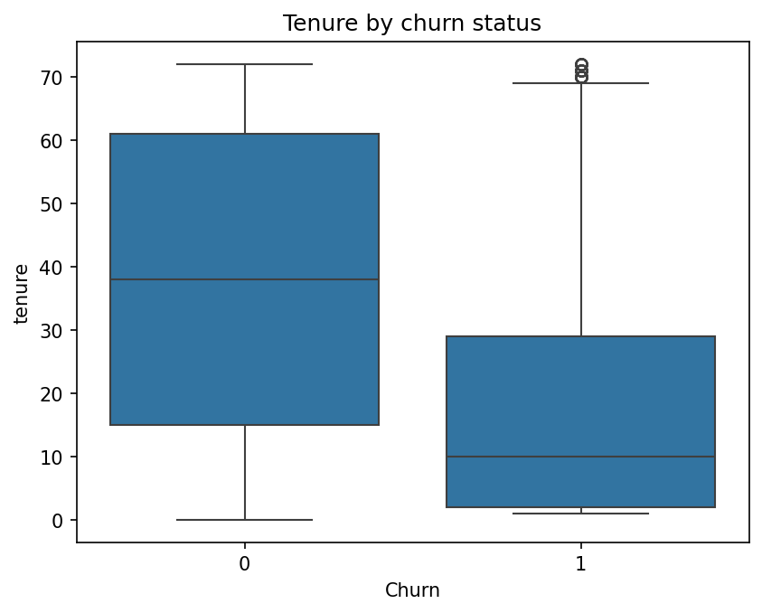
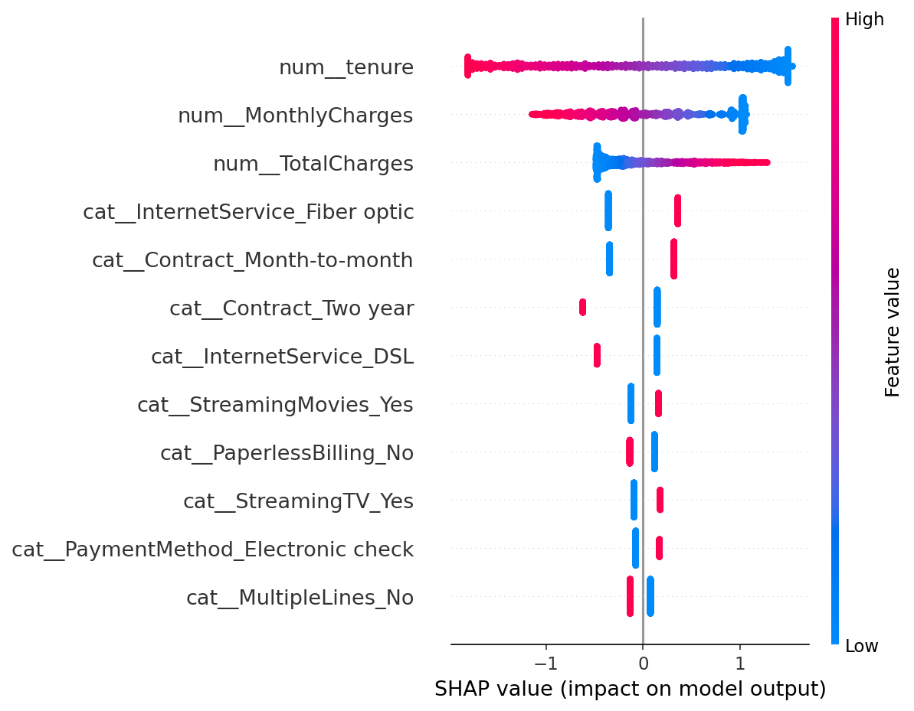
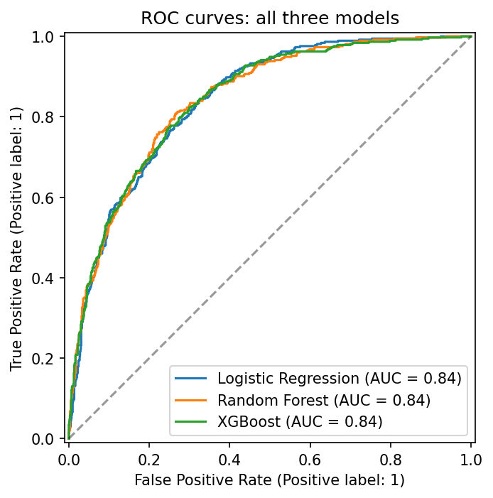
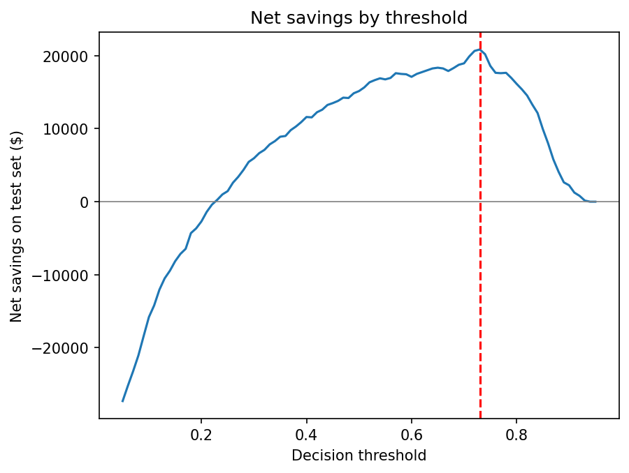

# Customer Churn Prediction (Telco)

Predicts which telecom customers are likely to leave and finds the
decision threshold that maximizes net savings from a retention offer.

## Problem
26.5% of customers in this dataset churn. Offering a discount to everyone
loses money, so the goal is to identify *who* to contact.

## Data
[Telco Customer Churn](https://www.kaggle.com/datasets/blastchar/telco-customer-churn)
(Kaggle, blastchar): 7,043 customers, 20 features. 80/20 stratified
train/test split (1,409 test customers).

## Key findings
- **Contract:** month-to-month churn ~43%, one-year ~11%, two-year ~3%.
- **Internet service:** fiber optic 41.9%, DSL 19.0%, no internet 7.4%.
- **Payment method:** electronic check 45.3% vs 15-19% for every other method.
- **Paperless billing:** 33.6% churn vs 16.3% without it.
- **Tenure** is the strongest driver in the SHAP analysis: newer customers
  are far more likely to churn than long-standing ones.
- These are associations, not proven causes. Fiber customers also pay
  higher monthly charges, so price and service type are tangled together.




## Models
Same preprocessing pipeline for all (scaling + one-hot encoding), 5-fold CV.

| Model | CV AUC | Test AUC | Precision | Recall | F1 |
|---|---|---|---|---|---|
| Logistic Regression | 0.845 | 0.842 | 0.504 | 0.783 | 0.614 |
| Random Forest | 0.846 | 0.842 | 0.552 | 0.749 | 0.636 |
| XGBoost | 0.844 | 0.842 | 0.512 | 0.786 | 0.620 |

All three tie on AUC, so I chose **Logistic Regression** as the simplest
and most explainable model.



## Business threshold
Assumptions (illustrative, not real company data): a retention offer costs
$100, a retained customer is worth $500, and the offer works 50% of the time.

| Strategy | Net savings (test set) |
|---|---|
| Contact everyone | -$47,400 |
| Default threshold 0.5 | $15,150 |
| Threshold 0.7 (chosen) | $18,950 |
| Peak at threshold 0.73 | $20,850 |

Savings stay high between roughly 0.6 and 0.75, so I use 0.7 rather than
the sharp peak. The threshold was tuned on the test set, so the savings
are slightly optimistic.



## Risk segments (test set)

| Segment | Customers | Actual churn |
|---|---|---|
| Low (< 0.4) | 715 | 7.0% |
| Medium (0.4 - 0.7) | 321 | 30.8% |
| High (> 0.7) | 373 | 60.3% |

The High segment is 26% of customers but contains about 60% of all churners.

## Recommendations
1. Offer discounts to move month-to-month customers onto 1-2 year contracts.
2. Focus retention effort on new customers, since churn risk is highest early.
3. Investigate fiber optic pricing and quality compared with competitors.
4. Incentivize electronic-check customers (about 45% churn) to switch to
   automatic payment (15-17% churn).

## Run it
```bash
pip install -r requirements.txt
python predict.py new_customers.csv
```
Outputs `predictions.csv` with each customer's churn probability and risk
segment. The saved model requires scikit-learn 1.6.1. The notebook was run
on Kaggle, so change the data path at the top if you run it elsewhere.

## Limitations
- Single dataset snapshot with no time dimension.
- Costs are assumptions, not real business figures.
- Tenure, MonthlyCharges and TotalCharges are correlated, which makes
  individual effects of these features hard to interpret.
